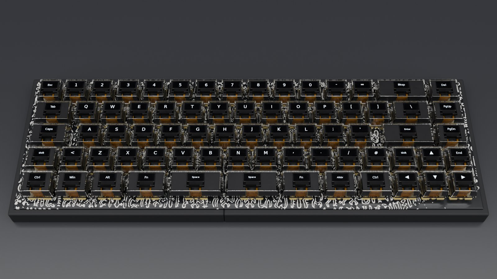
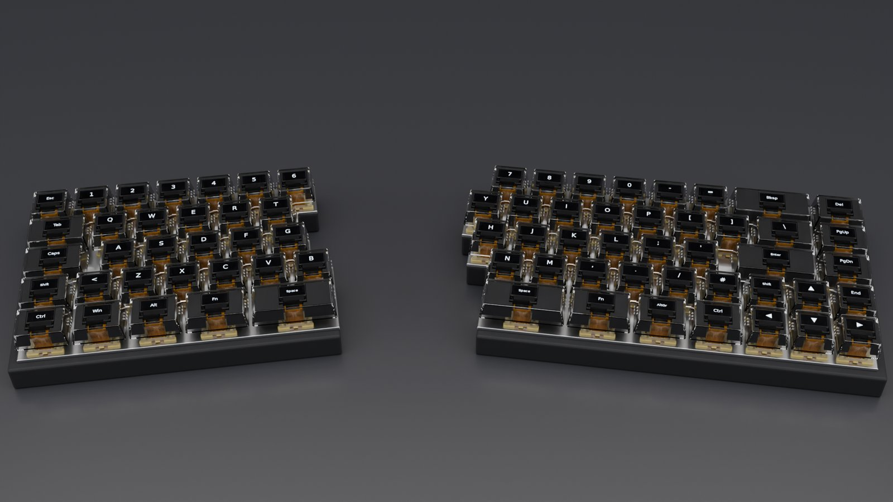

# split72s: staggered split keyboard (layout study)

split72s is a staggered split 65 % layout for PolyKybd. The two halves touch along the
standard split line (6/T/G/B on the left) and can be separated. Only 1, 1.25, 1.5 and 2U
keys are used, so every key has a display. The layout covers ANSI, ISO, JIS and ABNT2;
keys whose role depends on the language get their legend from the display.

This folder holds the layout study and the plate artwork. There is no KiCad board yet.





## Layout (layout E in the study)

- 72 keys, 16.25U wide, 5 rows, no F-row. Left half 31 keys, right half 41.
- Nav column Del, PgUp, PgDn (1.25U) and End, arrow keys in the bottom right.
- 2U Backspace, 2U Enter, the ISO `#` key in the Shift row before a 1U right Shift.
- Bottom row: Ctrl, Win, Alt 1.25U, then 1.5U and 2U thumb keys on each side of the split.
- Matrix: 6 x 7 per half (42 positions, 13 GPIOs as today); 6 display shift registers per
  half (41 displays on the right half) instead of 5.
- Plate: 5 mm border outside the keys, case rim 4 mm around the plate, both flush at the
  split line.

Files and the other layouts that were considered (TKL, 65 % variants, number blocks):
[layout_study/README.md](layout_study/README.md). The KLE and QMK layout data:
`layout_study/layout_e.kle.json`, `layout_study/layout_e.qmk.json`.

## Number block

An optional 4 x 5 block of 1U keys (20 keys, 5 x 4 matrix) docks on the right. It also
works as a macro pad. Data: `layout_study/numpad_n1.*.json`.

## Plate artwork

Rongorongo Tablet B, verso, traced from a 1935 photograph: [plate_art/](plate_art/README.md).
The artwork is CC BY-SA 4.0, separate from the hardware licence; see
[plate_art/ATTRIBUTION.md](plate_art/ATTRIBUTION.md).

## Renders

`render/layout_scene.py` renders a layout without a KiCad board, from copies of the real
1U key. Keys wider than 1U are the 1U parts with their walls moved out, so they are an
approximation. The case and plate are plain extrusions without screw holes or ports.

```bash
PK_PLATE_ART=poly_kybd/variations/split72s/plate_art/plate_art_tabletB_mask.png \
blender -b --python render/layout_scene.py -- \
    poly_kybd/variations/split72s/layout_study/layout_e_keys.json \
    poly_kybd/variations/split72s/layout_study/layout_e_legends.png \
    render/out/split72s.png 96 2400 joined 60
```

## Open points

- The KiCad boards: matrix 6 x 7 per half, 6 shift registers per half, the split
  connection between the touching halves.
- Stabilizers: the 2U keys (Backspace, Enter, space bars) have no stabilizer cut-outs yet.
- Caps and display carriers for 1.5U and 2U keys.
- The number block connection: its own MCU and USB, or wired into the right half.
